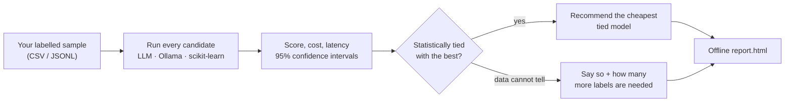

<p align="center">
  <picture>
    <source media="(prefers-color-scheme: dark)" srcset="https://raw.githubusercontent.com/mugil0095/tiebreak/master/docs/assets/logo-dark.svg">
    
  </picture>
</p>

<h3 align="center">Stop paying for the biggest model.<br>Pick the cheapest one that is statistically tied with the best, on your own data.</h3>

<p align="center">
  <a href="https://github.com/mugil0095/tiebreak/actions/workflows/ci.yml"></a>
  <a href="LICENSE"></a>
  
  
  
</p>

<p align="center">
  <a href="#two-minute-demo">Demo</a> &middot;
  <a href="#use-it-on-your-data">Your data</a> &middot;
  <a href="#more">Docs</a> &middot;
  <a href="docs/judge.md">Judge</a> &middot;
  <a href="#how-it-decides-in-four-lines">How it decides</a> &middot;
  <a href="#limits-in-short">Limits</a>
</p>

**Which model should you use for your task?** tiebreak runs several candidate models (hosted LLM APIs, local LLMs via Ollama, and classic scikit-learn models) on a small labelled sample of *your* data and reports score, cost and latency with 95% confidence intervals. It then recommends the **cheapest model that is statistically tied with the best**, or says plainly that your data cannot separate the candidates and roughly how many more labelled examples would. Everything runs on your machine and produces a self-contained offline `report.html`.

<p align="center">
  
</p>

*A real run (not the simulated demo below): 300 labelled rows, 3-class sentiment, one hosted model against a scikit-learn baseline. One task and one sample, so this is an example of the output, not a claim that classic ML beats LLMs in general.*

## Why tiebreak

| The usual way | With tiebreak |
|---|---|
| Pick the model at the top of a leaderboard | Measure candidates on **your** labelled sample |
| A 2-point score gap is read as a real gap | Paired bootstrap + Holm correction say whether it is noise |
| Only LLMs are compared | Hosted LLMs, local LLMs and classic ML side by side |
| Cost is an afterthought | Cost at your expected volume and latency sit next to every score |
| You get a ranking | You get a recommendation, or an honest "cannot separate" with the number of extra labels needed |



## Two-minute demo

```bash
git clone https://github.com/mugil0095/tiebreak && cd tiebreak
pip install -e ".[dev]"
tiebreak init --demo --dir demo
tiebreak run --task demo/task.yaml --models demo/models.yaml --data demo/data.csv
```

(`python -m tiebreak ...` works the same way.) The command prints the path of `report.html`; open it in a browser.

**The demo LLMs are SIMULATED.** The `sim-*` candidates use the `mock` provider: fake models with a preset accuracy that make no API calls. The report carries a SIMULATED banner. The demo only shows how tiebreak works; never use its results to choose a real model.

What the demo currently produces: `sim-large` has the highest score, but **`sim-small` is recommended**, because it is confirmed to be within the 0.05 margin of `sim-large` and is much cheaper.

## Real examples

Three free, reproducible runs on public data (AG News, SMS spam, SST-2) with scikit-learn models and a small local LLM: the winner differs by task, and the LLM was eliminated early on two of them. See [`examples/`](examples/README.md) and the [sample reports](https://mugil0095.github.io/tiebreak/).

## Use it on your data

```yaml
# task.yaml
type: classify            # classify | binary | extract_exact | regress | judge
label_column: sentiment
text_column: review
labels: [negative, neutral, positive]
margin: 0.02              # "tied" means within this much of the best score
```

```yaml
# models.yaml
- {name: hosted-a, kind: llm, provider: anthropic, model: "<model id from your account>"}   # any LiteLLM provider: pip install "tiebreak[llm]"
- {name: local-small, kind: llm, provider: ollama, model: "<local model tag>"}
- {name: logreg, kind: ml, estimator: logistic_regression}
```

```bash
tiebreak estimate --task task.yaml --models models.yaml --data mydata.csv                    # dry run, calls nothing
tiebreak run --task task.yaml --models models.yaml --data mydata.csv --yes-send-data         # hosted models need this flag
```

Pricing, reasoning models, rate limits and resuming: [docs/usage.md](docs/usage.md).

## More

| | |
|---|---|
| No right answers? A judge model scores the answers (Jev or any model) | [docs/judge.md](docs/judge.md) |
| Model prices and your run history (`tiebreak models`, `tiebreak history`) | [docs/judge.md](docs/judge.md#prices-and-history) |
| Jupyter helper and the local web app | [docs/notebook-and-web-app.md](docs/notebook-and-web-app.md) |
| How the decision is made and how it was validated | [docs/how-it-works.md](docs/how-it-works.md) |
| Safety switches and known limitations | [docs/safety-and-limits.md](docs/safety-and-limits.md) |

## How it decides

- A candidate is *tied* with the best only when we are 95% confident (Holm-adjusted) that it is no more than your margin below it. "Not significantly different" is never treated as "tied".
- It uses a paired bootstrap on the same resampled examples, plus a guard so models that rarely disagree are not tied from thin evidence.
- It recommends the cheapest tied candidate at your expected volume, or says the data cannot separate them and roughly how many more labels would.
- Incomplete or partly failed runs are marked provisional and say what is missing.

## Limits

- You need labelled data, or a judge model whose scores are only as good as the judge.
- Small samples are often inconclusive, and 4 or more similar candidates need many examples to confirm ties.
- Results hold for data that resembles your sample. Prices and latency are yours, not a provider benchmark.
- Hosted providers receive example text only with `--yes-send-data`; `--local-only` and `--max-cost` are available, and API keys come from environment variables only.

Everything else: [docs/safety-and-limits.md](docs/safety-and-limits.md).

## Contributing

```bash
pip install -e ".[dev]"
pytest                    # fast suite, no network
pytest -m slow            # statistical simulations
ruff check .
```

Opt-in live tests (`pytest -m live`) need a local Ollama model or your own Jev key; the default suite never touches the network. Licensed under Apache-2.0.
